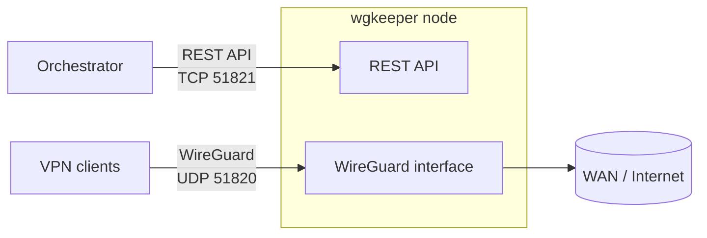

<p align="center">
  
</p>

<p align="center">A WireGuard node you manage over a REST API.</p>

<div align="center">

[](https://github.com/wgkeeper/wgkeeper-node/actions/workflows/ci.yml)
[](https://github.com/wgkeeper/wgkeeper-node/blob/main/LICENSE)
[](https://github.com/wgkeeper/wgkeeper-node/releases/latest)
[](https://github.com/wgkeeper/wgkeeper-node/pkgs/container/node)
[](https://codecov.io/gh/wgkeeper/wgkeeper-node)
[](https://scorecard.dev/viewer/?uri=github.com/wgkeeper/wgkeeper-node)

</div>

---

wgkeeper node runs one WireGuard interface on a Linux host and exposes an HTTP API to create, rotate, list and delete its peers. It has no UI and no user accounts: a single orchestrator holds the API key and manages many nodes. That orchestrator can be your own service or [wgkeeper console](https://github.com/wgkeeper/wgkeeper-console).

- Peers are created with an expiry or as permanent; expired peers are removed by the node itself.
- Keys can be rotated without changing the peer's IP address.
- IPv4, IPv6 or dual-stack, with NAT rules set up for you.
- Peers are stored in a local bbolt file and restored on the interface after every restart.
- Peers get internet access only: they can't reach each other, the node itself, cloud metadata or private networks unless you allow it.
- A small HTTP API with API key auth. HTTPS, IP filtering and rate limits are left to the reverse proxy you already use (Caddy, nginx, anything else); Caddy and nginx examples are included.
- Optional Prometheus metrics on a separate port with its own token.

## How it works



On every start the node writes the WireGuard config from `config.yaml` (addresses, listen port, NAT and isolation rules) and brings the interface up. The server key is generated once and kept, so its public key never changes. From then on, every peer change goes through the API and is stored on disk before it reaches the interface.

## Quick start

On a Linux server with kernel 5.6+ (Ubuntu 22.04 or newer, Debian 12 or newer):

```bash
curl -fsSL https://raw.githubusercontent.com/wgkeeper/wgkeeper-node/main/scripts/install.sh | sudo bash
```

The [install script](scripts/install.sh) installs Docker if it's missing, puts the node into `/opt/wgkeeper` with a new API key, starts it and prints the API address and key. Add `-s -- --domain node1.example.com` after `bash` to put Caddy with an automatic HTTPS certificate in front of the API. Read the script first if you prefer; [Deployment](docs/deployment.md) also covers installing by hand.

Create a peer:

```bash
curl -X POST http://127.0.0.1:51821/peers \
  -H "X-API-Key: <your api key>" \
  -H "Content-Type: application/json" \
  -d "{\"peerId\": \"$(cat /proc/sys/kernel/random/uuid)\"}"
```

The response has the server's public key and port, and the peer's keys and IP addresses: everything a client config needs. The peer's private key is returned only here and is not stored.

WireGuard listens on `51820/udp`. Without `--domain` the API is plain HTTP on `127.0.0.1:51821`, reachable from the server only.

## Documentation

- [Configuration](docs/configuration.md): requirements and every `config.yaml` key.
- [Deployment](docs/deployment.md): install script and updates, Docker Compose, reverse proxy (Caddy and nginx examples), building from source.
- [API reference](docs/api.md): endpoints, request fields and errors.
- [Peer store](docs/peer-store.md): how peers are persisted and restored after restarts.
- [Metrics](docs/metrics.md): Prometheus metrics, alerting rules and a Grafana dashboard.
- [Security](docs/security.md): what the node protects and how peers are isolated.

To report a vulnerability, see [SECURITY.md](SECURITY.md).

## Contributing

See [CONTRIBUTING.md](CONTRIBUTING.md) for setup, checks and the pull request flow, and [CHANGELOG.md](CHANGELOG.md) for changes in each release.

## License

[AGPL-3.0](LICENSE).

WireGuard® is a registered trademark of Jason A. Donenfeld.
